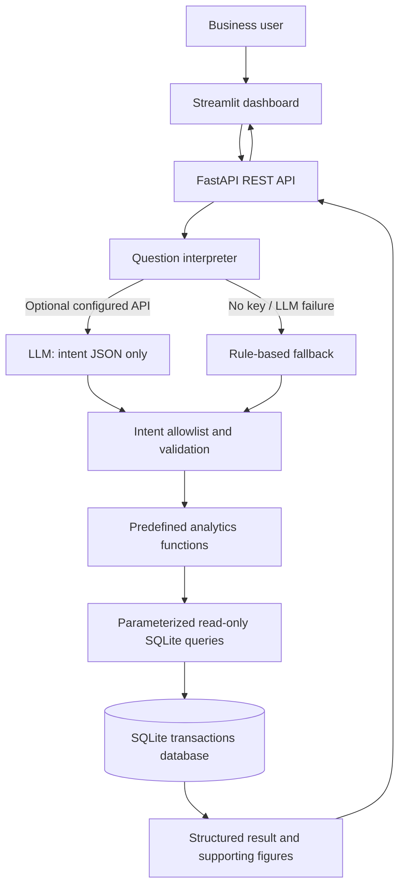

# Architecture

## Request flow

1. The user enters a natural-language question in Streamlit.
2. Streamlit sends the question to `POST /ask`.
3. `interpret_question()` optionally asks the LLM for a JSON intent. The model is explicitly instructed not to write SQL.
4. If no key is configured or the LLM request fails, a deterministic rule-based parser handles supported patterns.
5. The API validates the intent and required parameters.
6. A predefined analytics function executes SQL against SQLite with parameter binding.
7. The API returns an answer, raw supporting data, assumptions, warnings, and interpreter method.
8. Streamlit displays the result and any warnings.

## Data flow

`data/sales_data.csv` → Pandas validation → SQLite `transactions` table → analytics SQL → JSON API → Streamlit.

## Design choices

- SQLite avoids managing a separate database server for a small challenge dataset.
- FastAPI provides typed request validation and interactive API documentation.
- Streamlit keeps the UI simple and Python-based.
- The LLM interprets intent only; deterministic SQL calculates all business numbers.
- The rule-based fallback means the project remains usable without an LLM key.
